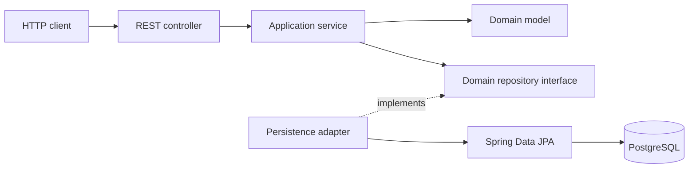

# Java Ledger Core

A learning project that implements a banking ledger REST API with Java 21, Spring Boot, and PostgreSQL. It focuses on domain modeling, double-entry bookkeeping, transactional transfers, and separation between business rules and infrastructure.

Designed and developed by **Samuel Baldasso**.

## Table of contents

- [Features](#features)
- [Technology stack](#technology-stack)
- [Architecture](#architecture)
- [Domain and persistence](#domain-and-persistence)
- [Getting started](#getting-started)
- [REST API](#rest-api)
- [Testing](#testing)
- [Architecture Decision Records](#architecture-decision-records)
- [Current limitations](#current-limitations)

## Features

- Open accounts with an initial zero balance.
- Retrieve account information, currency, status, and current balance.
- Transfer funds between different accounts in the same currency.
- Record a debit and a credit for every transfer.
- Retrieve an account statement from ledger entries.
- Protect balance updates with pessimistic database locks acquired in a deterministic order.
- Store a unique idempotency key and the original successful transfer response.
- Validate requests and return structured errors using Spring `ProblemDetail`.
- Apply versioned database migrations with Flyway.
- Explore the API through Swagger UI.
- Run the application and database with Docker Compose.

## Technology stack

| Component | Technology |
| --- | --- |
| Language | Java 21 |
| Application framework | Spring Boot 3.3.4 |
| HTTP API | Spring Web MVC |
| Validation | Jakarta Bean Validation |
| Persistence | Spring Data JPA / Hibernate |
| Database | PostgreSQL 16 |
| Schema migrations | Flyway |
| API documentation | Springdoc OpenAPI 2.6.0 |
| Build | Maven with Maven Wrapper |
| Tests | JUnit 5, AssertJ, Mockito, Spring Boot Test, Testcontainers |
| Containers | Docker and Docker Compose |

## Architecture

The project follows Clean Architecture principles, using domain repository interfaces as persistence ports and adapters to connect them to Spring Data JPA.

```text
src/main/java/com/sbaldasso/ledgercore/
├── domain/
│   ├── model/             Business entities, value objects, and exceptions
│   └── repository/        Persistence interfaces
├── application/
│   ├── usecase/           Use case contracts, commands, and results
│   └── service/           Use case implementations and transaction boundaries
└── infrastructure/
    ├── config/            OpenAPI configuration
    ├── persistence/
    │   ├── adapter/       Implementations of domain repository interfaces
    │   ├── entity/        JPA entities
    │   ├── mapper/        Domain ↔ persistence conversion
    │   └── repository/    Spring Data repositories and locking queries
    └── web/
        ├── controller/    REST endpoints
        ├── dto/           Request and response models
        └── exception/     Centralized HTTP error handling
```



The domain model has no Spring or JPA dependencies. Application services orchestrate business operations and use Spring transaction management. Infrastructure contains framework-specific concerns; dedicated mappers keep JPA entities separate from domain entities.

### Transfer flow

1. Look up the stored transfer receipt and compare all request fields. Equal requests replay the original response; different requests return HTTP 409.
2. Reject historical keys whose original response was never stored.
3. Order the two account UUIDs and acquire pessimistic write locks in that order.
4. Check the receipt again after acquiring locks, in case a concurrent winner committed while this request waited.
5. Debit the source, credit the target, and create balanced ledger entries.
6. Insert the receipt with the original request and resulting balances, committing all changes together.
7. On a persistence collision, roll back the entire attempt, then read the winner in a new transaction. Return its response for equal requests or HTTP 409 for different requests.

Deterministic account lock ordering reduces deadlock risk. Unique keys prevent duplicate committed transfers. The failed attempt must finish rolling back before recovery begins. Each transfer owns an independent transaction; it does not join a caller's existing transaction. See ADRs 0010-0012 for the contract and trade-offs.

## Domain and persistence

### Domain model

| Model | Responsibility |
| --- | --- |
| `Money` | Immutable amount and currency; uses `BigDecimal` and currency-specific scale with `HALF_EVEN` rounding |
| `Account` | Encapsulates balance changes, account status, insufficient-funds checks, and currency compatibility |
| `Transaction` | Groups entries and validates that total debits equal total credits in a single currency |
| `Entry` | Immutable positive debit or credit associated with an account |

Accounts cannot be debited beyond their available balance. Transfers require distinct source and target accounts. The domain also supports closing a zero-balance account and changing its owner name, although these operations are not exposed through the API.

### Database schema

- **`accounts`**: UUID identity, unique account number, owner name, balance, currency, status, and creation timestamp.
- **`transactions`**: UUID identity, description, creation timestamp, and unique idempotency key.
- **`entries`**: UUID identity, transaction reference, account reference, debit/credit type, amount, and currency.
- **`transfer_receipts`**: unique key, original request, transaction reference, resulting balances, and execution timestamp for replay.

Amounts use `NUMERIC(19, 4)`. Database constraints reject negative account balances, non-positive entry amounts, and invalid entry types. Foreign keys use `ON DELETE RESTRICT`, and entry lookups have indexes on transaction and account IDs. Balance between debits and credits is validated in the domain; it is not enforced by a database constraint.

| Migration | Purpose |
| --- | --- |
| [V1](src/main/resources/db/migration/V1__create_accounts_and_ledger_tables.sql) | Create account, transaction, and entry tables with constraints and indexes |
| [V2](src/main/resources/db/migration/V2__add_idempotency_key_to_transactions.sql) | Add the required idempotency key and its unique index |
| [V3](src/main/resources/db/migration/V3__create_transfer_receipts.sql) | Store successful requests and their original transfer responses |

Hibernate uses `ddl-auto: validate`, while Flyway manages schema changes. Open Session in View is disabled.

## Getting started

### Run with Docker Compose

Requirements: Docker with Docker Compose support and available ports `8080` and `5432`.

```bash
git clone https://github.com/samuelbaldasso/java-ledger-core.git
cd java-ledger-core
docker compose up --build
```

Compose starts PostgreSQL, waits for its health check, and starts the application. Database data is stored in the `pgdata` volume. The application image uses a separate build stage and runs as a non-root user.

- API base URL: `http://localhost:8080/api/v1`
- Swagger UI: `http://localhost:8080/swagger-ui.html`
- OpenAPI JSON: `http://localhost:8080/v3/api-docs`

Stop the services while keeping database data:

```bash
docker compose down
```

The credentials in `compose.yaml` are local development defaults.

### Run locally with Java

Requirements: JDK 21 and Docker for the database. The Maven Wrapper downloads Maven when needed.

Start only PostgreSQL:

```bash
docker compose up -d postgres
```

Configure the datasource and start the application on macOS/Linux:

```bash
export SPRING_DATASOURCE_URL=jdbc:postgresql://localhost:5432/ledger_db
export SPRING_DATASOURCE_USERNAME=ledger_user
export SPRING_DATASOURCE_PASSWORD=ledger_password
./mvnw spring-boot:run
```

On Windows PowerShell:

```powershell
$env:SPRING_DATASOURCE_URL = 'jdbc:postgresql://localhost:5432/ledger_db'
$env:SPRING_DATASOURCE_USERNAME = 'ledger_user'
$env:SPRING_DATASOURCE_PASSWORD = 'ledger_password'
.\mvnw.cmd spring-boot:run
```

Run either the local application or the Compose application on port `8080` at a time.

### Configuration

| Environment variable | Local Compose value |
| --- | --- |
| `SPRING_DATASOURCE_URL` | `jdbc:postgresql://postgres:5432/ledger_db` inside Compose; use `localhost` from the host |
| `SPRING_DATASOURCE_USERNAME` | `ledger_user` |
| `SPRING_DATASOURCE_PASSWORD` | `ledger_password` |

## REST API

| Method | Endpoint | Success response |
| --- | --- | --- |
| `POST` | `/api/v1/accounts` | `201 Created`, account body, and `Location` header |
| `GET` | `/api/v1/accounts/{id}` | `200 OK`, account details and balance |
| `GET` | `/api/v1/accounts/{id}/statement` | `200 OK`, account ID and ledger entries |
| `POST` | `/api/v1/transfers` | `200 OK`, transfer result; requires `Idempotency-Key` |

### Open an account

```bash
curl -X POST http://localhost:8080/api/v1/accounts \
  -H 'Content-Type: application/json' \
  -d '{
    "accountNumber": "1001-1",
    "ownerName": "Alice",
    "currency": "BRL"
  }'
```

The response contains `id`, `accountNumber`, `ownerName`, `balance`, `currency`, `status`, and `createdAt`. New accounts have a zero balance and `ACTIVE` status. Save the returned ID to query the account or use it in a transfer.

### Retrieve an account and its statement

Replace `ACCOUNT_ID` with a returned account UUID:

```bash
curl http://localhost:8080/api/v1/accounts/ACCOUNT_ID
curl http://localhost:8080/api/v1/accounts/ACCOUNT_ID/statement
```

Each statement entry includes its transaction ID, description, debit/credit type, amount, currency, and timestamp. Transactions are queried by creation time in descending order. Statements are currently unpaginated.

### Transfer funds

Replace both account IDs with real UUIDs. The source must already have sufficient funds, and both accounts must use the requested currency.

```bash
curl -X POST http://localhost:8080/api/v1/transfers \
  -H 'Content-Type: application/json' \
  -H 'Idempotency-Key: 9b1deb4d-3b7d-4bad-9bdd-2b0d7b3dcb6d' \
  -d '{
    "sourceAccountId": "00000000-0000-0000-0000-000000000001",
    "targetAccountId": "00000000-0000-0000-0000-000000000002",
    "amount": 25.00,
    "currency": "BRL",
    "description": "Payment"
  }'
```

The response includes `transactionId`, source and target IDs, `transferredAmount`, `currency`, both resulting balances, and `executedAt`.

There is currently no deposit endpoint or funding seed. Accounts created through the API alone cannot make a positive transfer until a funded fixture is provided. Unit tests create funded domain accounts to exercise transfers. Directly changing a database balance does not create the corresponding ledger entries.

Use one key per transfer intent (a non-blank string of at most 128 characters; UUID format is not required). Repeating the same request returns the original response, including the balances at that time. Changing source, target, amount, currency, or description with the same key returns HTTP 409. Numeric values such as 100.0 and 100.00 are equivalent; descriptions are compared exactly. The API rejects amounts that would require currency rounding. Description length is limited to 255 characters.

Only successful results are stored. Historical keys from before V3 have no reliable response snapshot and return HTTP 409 with type `idempotency-result-unavailable`; do not resubmit the payment with another key without investigating the original operation.

### Error responses

Application errors use `ProblemDetail`, with fields such as `type`, `title`, `status`, `detail`, and `timestamp`. Validation errors also contain an `errors` map.

| Status | Typical cause |
| --- | --- |
| `400 Bad Request` | Request validation failure, missing idempotency header, currency mismatch, or invalid argument |
| `404 Not Found` | Account does not exist |
| `409 Conflict` | Account number conflict, changed data for an existing transfer key, or historical response unavailable |
| `422 Unprocessable Entity` | Insufficient funds or inactive account |
| `500 Internal Server Error` | Unexpected errors, including database conflicts without a committed transfer receipt |

## Testing

Run the full suite with a running Docker engine:

```bash
./mvnw test
```

Windows PowerShell:

```powershell
.\mvnw.cmd test
```

Tests include:

- Domain rules for money, accounts, and balanced transactions.
- Account-opening and transfer services with mocked repositories.
- Transfer lock acquisition order, original-response replay, and conflicts for changed request fields.
- PostgreSQL tests for concurrent retries, collision rollback, and atomic rollback after receipt persistence.
- MVC request validation, response mapping, and error handling.
- Domain/JPA mapper round trips.
- Application context startup with PostgreSQL 16 through Testcontainers and Spring Boot `@ServiceConnection`.

The context test needs Docker. Tests that do not require the PostgreSQL container can be run separately:

```bash
./mvnw '-Dtest=*Test' test
```

The singular `*Test` pattern excludes `LedgerCoreApplicationTests` and `TransferIdempotencyIntegrationTests`, which require Docker. The integration suite coordinates concurrent requests with barriers and verifies balances, entry counts, balanced debit/credit totals, and stored receipts.

If the older Docker client bundled with this project's Testcontainers cannot connect to Docker 29, the following API override was verified in the development environment:

```powershell
.\mvnw.cmd '-Dapi.version=1.44' test
```

This flag changes the test client's API version; it does not change Docker's configuration.

Build a JAR, including the full test suite:

```bash
./mvnw clean package
```

The Dockerfile skips tests during its image build; run the test suite separately before relying on an image.

## Architecture Decision Records

The ADRs document the reasoning and trade-offs behind the design. Existing records are written in Portuguese.

| ADR | Decision |
| --- | --- |
| [0001](docs/adr/0001-money-value-object-modeling.md) | Model monetary values as a `Money` value object |
| [0002](docs/adr/0002-account-entity-and-balance-encapsulation.md) | Encapsulate balances and account invariants in `Account` |
| [0003](docs/adr/0003-double-entry-ledger-transaction-modeling.md) | Model double-entry bookkeeping with transactions and entries |
| [0004](docs/adr/0004-persistence-architecture-postgresql-and-pessimistic-locking.md) | Use PostgreSQL, Flyway, separate JPA entities, and pessimistic locking |
| [0005](docs/adr/0005-deadlock-prevention-via-deterministic-lock-ordering.md) | Acquire account locks in deterministic order |
| [0006](docs/adr/0006-transaction-idempotency-via-unique-key.md) | Store unique transaction idempotency keys |
| [0007](docs/adr/0007-rest-api-design-and-rfc-7807-error-handling.md) | Define REST contracts and structured `ProblemDetail` errors |
| [0008](docs/adr/0008-account-management-and-statement-api.md) | Expose account creation, account queries, and statements |
| [0009](docs/adr/0009-openapi-documentation-and-containerization.md) | Provide OpenAPI documentation and Docker execution |
| [0010](docs/adr/0010-original-transfer-response-and-conflict.md) | Replay the original response and reject changed requests |
| [0011](docs/adr/0011-separate-transfer-receipt-storage.md) | Store transfer receipts separately from accounting records |
| [0012](docs/adr/0012-idempotency-collision-recovery-after-rollback.md) | Recover concurrent collisions after complete rollback |

See also the [architecture documentation index](docs/README.md). ADR 0006 is partially superseded by 0010-0012. Append-only enforcement remains a limitation.

## Current limitations

This is an educational implementation with the following areas still open:

- **Receipt lifecycle:** only successful responses are retained, without expiration. Historical transfers without a receipt cannot reproduce an original response. Key retention and access scoping need explicit decisions before adding cleanup or multi-tenant access.
- **Concurrent conflicts:** transfer key collisions are recovered after rollback. General deadlocks, timeouts, and concurrent account-number creation do not yet have dedicated recovery policies.
- **Integration coverage:** transfer idempotency concurrency and rollback are tested on PostgreSQL. Full reconciliation from ledger-backed initial funding and load testing remain open; integration fixtures currently fund accounts directly.
- **Funding:** no deposit API or ledger-balanced initial funding workflow is implemented.
- **Ledger immutability:** foreign keys restrict deletion of referenced parents; they do not make ledger records append-only. Updates and entry deletion are not comprehensively prohibited by database permissions or triggers.
- **Statements:** no pagination, date filters, or explicit fetch optimization for entry loading; the lazy collection mapping can cause N+1 queries.
- **Input bounds:** transfer key and description lengths are validated and the transfer API rejects currency rounding. Other string lengths and numeric limits are not fully validated against database column limits.
- **Migration of existing data:** V2 adds a required column without a backfill, so upgrading a database containing transactions needs an additional migration strategy.
- **Operations and access control:** authentication, authorization, application health endpoints, metrics, tracing, explicit error logging, and a CI pipeline are not implemented.
